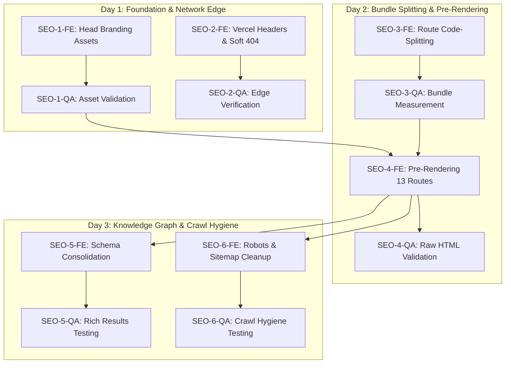

# Master Task Index: Technical & On-Page SEO 10/10 Optimization

**Epic Reference:** `SEO-EPIC-01` — NEETFORGE Technical SEO & Social Optimization  
**Feature Slug:** `seo-optimization`  
**Target Milestone:** Sprint 1 — Production Readiness  
**Overall Epic Status:** ✅ Completed  
**Technical Lead Sign-off:** ✅ All Technical Contracts Resolved (Zero STOPs)  

---

## 1. Master Sub-Tasks Tracking Table

| Subtask ID | Parent Story | Title | Primary Discipline | Target Files | Points | Dependencies | Status |
| :---: | :---: | :--- | :--- | :--- | :---: | :---: | :---: |
| **SEO-1-FE** | SEO-1 | Create Head Static Assets & Wire HTML Links | Frontend / Assets | `/public/og-image.png` `/public/favicon.svg` `/public/apple-touch-icon.png` `/public/manifest.json` `/index.html` | 2 | None | ✅ Done |
| **SEO-1-QA** | SEO-1 | Validate Asset MIME Types, Dimensions & Responses | QA / Verification | `/public/og-image.png` `/public/favicon.svg` `/public/apple-touch-icon.png` `/public/manifest.json` | 1 | SEO-1-FE | ✅ Done |
| **SEO-2-FE** | SEO-2 | Configure Vercel Security Headers & Immutable Cache | DevOps / Config | `/vercel.json` | 2 | None | ✅ Done |
| **SEO-2-QA** | SEO-2 | Verify Edge Security Headers, Cache & 404 Behavior | QA / Verification | `/vercel.json` | 1 | SEO-2-FE | ✅ Done |
| **SEO-3-FE** | SEO-3 | Implement Route Code-Splitting & Vendor Chunking | Frontend Architecture | `/src/App.tsx` `/vite.config.ts` | 3 | None | ✅ Done |
| **SEO-3-QA** | SEO-3 | Measure Marketing Bundle Size & Test Lazy Chunks | QA / Verification | `/src/App.tsx` `/vite.config.ts` | 2 | SEO-3-FE | ✅ Done |
| **SEO-4-FE** | SEO-4 | Standardize Route Metadata & Pre-Render 13 Routes | Frontend / Build | `/src/marketing/components/Seo.jsx` `/src/marketing/pages/*.jsx` `/scripts/prerender.mjs` `/package.json` | 5 | SEO-1-FE, SEO-3-FE | ✅ Done |
| **SEO-4-QA** | SEO-4 | Verify Raw HTML Titles, Canonicals & Pre-Rendered DOM | QA / Verification | `/dist/**/*.html` | 3 | SEO-4-FE | ✅ Done |
| **SEO-5-FE** | SEO-5 | Consolidate Schema Graph & Implement FAQ Rich Snippets | Frontend / Schema | `/index.html` `/src/marketing/pages/Home.jsx` `/src/marketing/pages/FAQ.jsx` `/src/marketing/components/neetforge/NeetFAQ.jsx` | 3 | SEO-1-FE, SEO-4-FE | ✅ Done |
| **SEO-5-QA** | SEO-5 | Validate Schema.org Graph & Rich Snippet Compliance | QA / Verification | `/src/marketing/pages/Home.jsx` `/src/marketing/pages/FAQ.jsx` | 2 | SEO-5-FE | ✅ Done |
| **SEO-6-FE** | SEO-6 | Clean Sitemap, Update Robots.txt & Add Auth Noindex | DevOps / Frontend | `/public/robots.txt` `/public/sitemap.xml` `/src/pages/Login.tsx` `/src/pages/Signup.tsx` | 1 | SEO-4-FE | ✅ Done |
| **SEO-6-QA** | SEO-6 | Validate Robots Rules, Sitemap XML & Noindex Tags | QA / Verification | `/public/robots.txt` `/public/sitemap.xml` `/src/pages/Login.tsx` `/src/pages/Signup.tsx` | 1 | SEO-6-FE | ✅ Done |

---

## 2. Granular Technical Subtasks Breakdown

### Story SEO-1: Missing Head Static Assets & Social Graph Media Resolution
- [x] **SEO-1-FE (Frontend/Assets):**
  - Generate `/public/og-image.png` (1200x630, PNG, < 250 KB) with high-contrast NEETFORGE branding.
  - Generate `/public/favicon.svg` (valid XML vector icon).
  - Generate `/public/apple-touch-icon.png` (180x180 square PNG).
  - Author valid `/public/manifest.json` referencing `/favicon.ico` and `/apple-touch-icon.png`.
  - Update `/index.html` head tags to link `apple-touch-icon`, `favicon.svg`, and `manifest.json`.
- [x] **SEO-1-QA (QA/Verification):**
  - Execute automated bash/curl script verifying MIME types (`image/png`, `image/svg+xml`, `application/json`).
  - Assert zero assets return HTML fallback (`<!doctype html>`).
  - Verify `og-image.png` file size is under 250 KB and dimensions are exactly 1200x630.

### Story SEO-2: Production HTTP Security & Immutable Cache-Control Headers
- [x] **SEO-2-FE (DevOps/Config):**
  - Configure `Cache-Control: public, max-age=31536000, immutable` for `/assets/(.*)` in `vercel.json`.
  - Add mandatory security headers in `vercel.json` (`nosniff`, `SAMEORIGIN`, `strict-origin-when-cross-origin`, `Permissions-Policy`, HSTS preload).
  - Add edge redirects for legacy root paths to `/app/*`.
  - Scope SPA rewrite strictly to `/app/(.*)` to eliminate soft 404 masking on non-existent assets and dead pages.
- [x] **SEO-2-QA (QA/Verification):**
  - Run curl test asserting presence of all 5 security headers on document responses.
  - Assert 1-year immutable caching on content-hashed static assets.
  - Assert non-existent URLs (e.g. `/this-route-does-not-exist-404-test`) return true HTTP 404.

### Story SEO-3: Route-Level Code-Splitting & Marketing Bundle Size Optimization
- [x] **SEO-3-FE (Frontend Architecture):**
  - Refactor `src/App.tsx` routes with `React.lazy` and `<Suspense>` fallback, separating marketing pages from the authenticated app suite.
  - Isolate heavy internal dependencies (Recharts, exam simulators, ReactFlow) into deferred async chunks.
  - Configure Rollup `manualChunks` in `vite.config.ts` to cleanly isolate vendor packages (`vendor-react`, `vendor-ui`, `vendor-charts`, `vendor-icons`).
- [x] **SEO-3-QA (QA/Verification):**
  - Analyze production build output to confirm initial marketing JavaScript bundle is < 100 KB gzipped (< 250 KB raw).
  - Assert `recharts` is excluded from the marketing entry chunk.
  - Verify smooth `<Suspense>` route transitions without visual flickering or layout shifts.

### Story SEO-4: Static Pre-Rendering (SSG) for Marketing Routes & Raw HTML Canonical Isolation
- [x] **SEO-4-FE (Frontend/Build):**
  - Standardize `src/marketing/components/Seo.jsx` and wire it across all 13 marketing pages with unique title, meta description, and self-referencing canonical path.
  - Create deterministic post-build pre-rendering pipeline in `scripts/prerender.mjs`.
  - Update `package.json` build command to execute pre-rendering (`vite build && node scripts/prerender.mjs`).
  - Generate pre-rendered static HTML files for all 13 routes with semantic heading structures and body copy.
- [x] **SEO-4-QA (QA/Verification):**
  - Execute automated crawler test inspecting all 13 generated HTML files.
  - Assert each route contains its distinct `<title>` and self-referencing `<link rel="canonical">`.
  - Assert zero pages point canonical to homepage (eliminating canonical cannibalization).
  - Assert `
` contains crawlable semantic text and `<h1>` headings.

### Story SEO-5: Schema.org Structured Data Consolidation & FAQPage Rich Snippets
- [x] **SEO-5-FE (Frontend/Schema):**
  - Remove colliding, hardcoded JSON-LD scripts from root `index.html` (lines 48–116).
  - Implement single unified `@graph` schema in `src/marketing/pages/Home.jsx` (Organization, WebSite, SoftwareApplication).
  - Remove fictitious `SearchAction` and unverified `aggregateRating`.
  - Add verified official social profiles in `sameAs` array.
  - Implement compliant `FAQPage` schema on `/faq` and ensure DOM accordion text is accessible.
- [x] **SEO-5-QA (QA/Verification):**
  - Run JSON-LD schema parser asserting exactly 1 structured data block on homepage.
  - Validate schema conformance against Google Rich Results guidelines (zero warnings).
  - Assert all 12 FAQ questions and answers in schema match DOM copy verbatim.

### Story SEO-6: Search Crawl Budget Optimization, Robots.txt & Clean Sitemap Hygiene
- [x] **SEO-6-FE (DevOps/Frontend):**
  - Update `public/robots.txt` with explicit `Disallow: /app/` to isolate private application areas from search crawlers.
  - Prune `public/sitemap.xml` by removing `/app/login` and `/app/signup`, cataloging strictly the 13 canonical marketing URLs.
  - Add dynamic `noindex, nofollow` robot directives on `src/pages/Login.tsx` and `src/pages/Signup.tsx`.
- [x] **SEO-6-QA (QA/Verification):**
  - Run XML validator on `public/sitemap.xml` asserting valid schema and exactly 13 URLs.
  - Assert `robots.txt` contains `Disallow: /app/` and canonical `Sitemap:` reference.
  - Verify `noindex, nofollow` metadata is injected when visiting login and signup screens.

---

## 3. Recommended Execution Sequence for `@code`

---

## 4. Verification Checkpoint Before Production Release
Prior to closing the epic:
1. `npm run build` must complete cleanly, outputting all 13 pre-rendered routes into `dist/`.
2. All 6 QA verification scripts (`SEO-1-QA` through `SEO-6-QA`) must report **100% PASS**.
3. Direct `curl -I` on deployment preview must show valid image MIME types, immutable caching on `/assets/`, and strict security headers.
